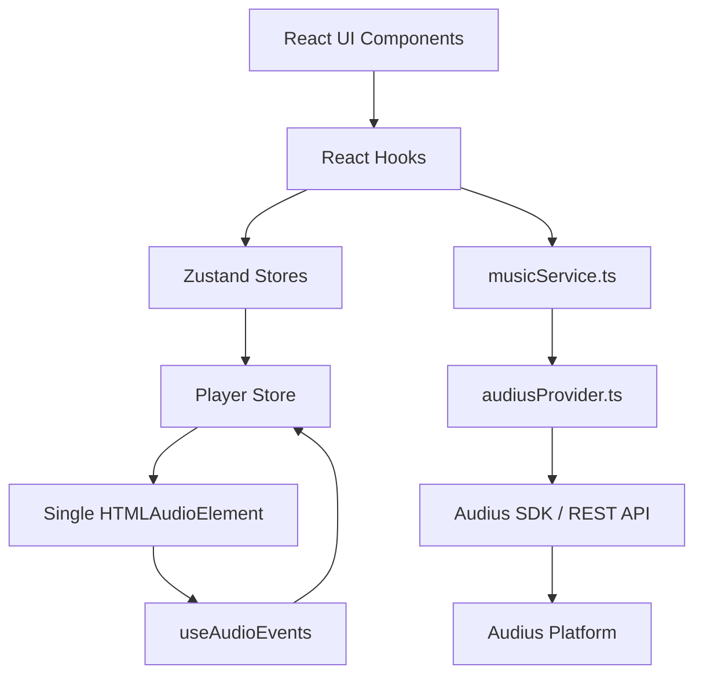
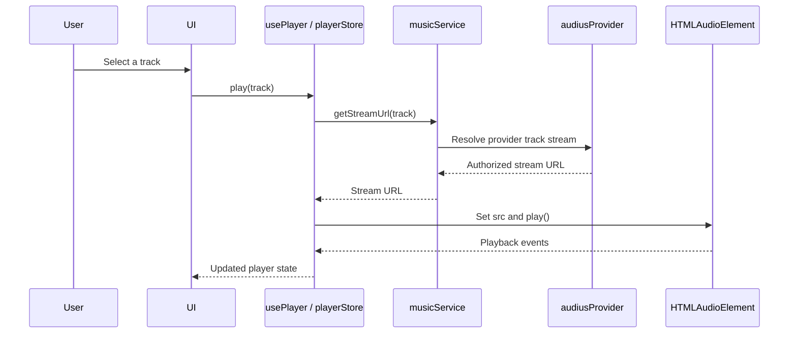

<div align="center">

# OpenMusic

### Discover. Stream. Build your own music library.

A modern, responsive music discovery and streaming web application powered by the **Audius platform**.

[](https://react.dev/)
[](https://www.typescriptlang.org/)
[](https://vite.dev/)
[](https://tailwindcss.com/)
[](https://docs.audius.co/)

[Repository](https://github.com/pradheepc05/openmusic) · [Audius API Docs](https://docs.audius.co/) · [Report a Bug](https://github.com/pradheepc05/openmusic/issues)

</div>

---

## About

**OpenMusic** is an independent music discovery and streaming web application. It uses the official Audius API to let listeners discover music, search for tracks, stream available tracks, explore playlists and artists, save favorites, and create personal playlists.

The application is being developed as a responsive web experience for desktop, tablet, and mobile browsers. An Android application may be considered after the web MVP is stable and tested.

> OpenMusic is an independent project and is not an official Audius product. It is not endorsed by or affiliated with Audius.

## Contents

- [Project Goals](#project-goals)
- [Features](#features)
- [Technology Stack](#technology-stack)
- [Architecture](#architecture)
- [Project Structure](#project-structure)
- [Getting Started](#getting-started)
- [Audius API Configuration](#audius-api-configuration)
- [Available Scripts](#available-scripts)
- [Development Roadmap](#development-roadmap)
- [Security, Privacy and Music Rights](#security-privacy-and-music-rights)
- [Contributing](#contributing)
- [License](#license)
- [Author](#author)

## Project Goals

OpenMusic aims to provide a clean, responsive listening experience while keeping the codebase modular, maintainable, and suitable for future development.

Core principles:

- **Audius only:** Audius is the sole music provider for the MVP.
- **Web first:** Complete and test the web application before starting Android development.
- **Local-first library:** Favorites, recently played tracks, and user-created playlists are stored locally.
- **Persistent playback:** Music playback should continue when users navigate between application routes.
- **Provider isolation:** Audius-specific API details stay inside the provider adapter.
- **Responsible streaming:** Use authorized Audius stream endpoints and respect track availability and licensing.

## Features

### MVP feature scope

| Area | Planned capability |
|---|---|
| Discovery | Trending tracks and popular genres |
| Search | Search Audius tracks with debounced input |
| Playlists | Discover Audius playlists and view playlist details |
| Artists | Search and display public artist information |
| Player | Persistent player with play, pause, seek, and volume |
| Queue | Next, previous, shuffle, repeat one, and repeat all |
| Library | Local favorites and recently played tracks |
| Personal playlists | Create, rename, edit, and delete local playlists |
| Responsive UI | Desktop, tablet, and mobile browser layouts |
| Reliability | Loading, empty, offline, and error states |

### Not included in the MVP

The following are intentionally excluded until the core web application is stable:

- Other music providers or streaming integrations.
- Audio extraction from third-party platforms.
- Paid subscriptions and monetization.
- A custom backend or account system.
- Audius OAuth and user-authorized actions.
- Machine-learning recommendations.
- Native Android application.
- PWA/service-worker functionality.
- Microservices.

## Technology Stack

| Category | Technology | Role |
|---|---|---|
| Frontend | React 18 | Component-based UI |
| Language | TypeScript 5 | Strictly typed application code |
| Build tool | Vite 5 | Development server and production builds |
| Styling | Tailwind CSS 4 | Responsive styling |
| Routing | React Router DOM 6 | Client-side navigation |
| HTTP | Axios | Shared HTTP utilities where raw REST is used |
| State | Zustand | Player and library state |
| Persistence | Zustand Persist / localStorage | Local user library data |
| Icons | Lucide React | Interface icons |
| Audio | HTML5 Audio API | Browser audio playback |
| Music API | Audius REST API / official SDK | Music discovery and stream resolution |
| Testing | Vitest, React Testing Library | Tests planned for Phase 6 |
| Linting | ESLint | Code quality |
| Runtime | Node.js 24.x | Development and build environment |
| Package manager | npm | Dependency management |
| Hosting | Vercel | Web deployment |

The MVP intentionally uses one state manager, one HTTP client, and one music provider. Avoid adding unnecessary dependencies or backend services.

## Architecture

OpenMusic separates the UI, application state, music service, provider adapter, and audio engine. UI components work with normalized application models rather than raw Audius API responses.



### Main architectural rules

- All Audius API and SDK operations go through `src/services/providers/audiusProvider.ts`.
- `musicService.ts` is the application-facing service facade.
- `trackMapper.ts` converts provider responses into the application's `Track` model.
- UI components must never depend on raw Audius response shapes.
- Only `src/services/audio.ts` creates the application's `HTMLAudioElement`.
- `useAudioEvents()` is mounted once in `MainLayout.tsx`.
- Stream URLs are resolved when playback starts and are never persisted.
- Queue state and saved playlists are separate concepts.

### Playback flow



## Project Structure

The following is the intended high-level structure. The repository may evolve as implementation progresses.

```text
openmusic/
├── public/
│   ├── favicon.svg
│   ├── logo.svg
│   └── images/
├── docs/
│   ├── README.md
│   ├── ROADMAP.md
│   ├── phase-01-foundation.md
│   ├── phase-02-ui.md
│   ├── phase-03-audio-engine.md
│   ├── phase-04-audius-integration.md
│   ├── phase-05-library.md
│   ├── phase-06-testing.md
│   └── phase-07-deployment.md
├── src/
│   ├── assets/
│   ├── components/
│   │   ├── common/
│   │   ├── layout/
│   │   └── music/
│   ├── pages/
│   ├── services/
│   │   ├── providers/
│   │   └── mappers/
│   ├── hooks/
│   ├── store/
│   ├── constants/
│   ├── mocks/
│   ├── types/
│   ├── utils/
│   ├── styles/
│   ├── App.tsx
│   └── main.tsx
├── .env.example
├── .gitignore
├── .nvmrc
├── package.json
├── package-lock.json
├── tsconfig.json
├── vite.config.ts
├── vercel.json
├── README.md
├── LICENSE
└── project.md
```

For the authoritative file responsibilities, data models, implementation rules, and phase acceptance criteria, see [`project.md`](./project.md).

## Getting Started

### Prerequisites

Install the following:

- [Node.js 24.x](https://nodejs.org/)
- npm (included with Node.js)
- [Git](https://git-scm.com/)
- An Audius developer API key for the documented keyed browser SDK workflow.

Check your installed versions:

```bash
node --version
npm --version
git --version
```

### 1. Clone the repository

```bash
git clone https://github.com/pradheepc05/openmusic.git
cd openmusic
```

### 2. Install dependencies

```bash
npm install
```

### 3. Configure environment variables

Copy the example environment file:

**Windows PowerShell**
```powershell
Copy-Item .env.example .env.local
```

**macOS / Linux**
```bash
cp .env.example .env.local
```

Add your public Audius API key to `.env.local`:

```env
VITE_AUDIUS_API_KEY=your_public_audius_api_key
```

The API key is optional only if the selected documented public endpoints support requests without it. Follow the current Audius SDK/API documentation for the chosen access method.

### 4. Start the development server

```bash
npm run dev
```

Open the local URL printed by Vite, usually:

```text
http://localhost:5173
```

## Audius API Configuration

Audius is the only music provider in the MVP.

Official resources:

- [Audius developer documentation](https://docs.audius.co/)
- [Audius API reference](https://docs.audius.co/api/)
- [Audius JavaScript SDK](https://docs.audius.co/sdk/)
- [Audius developer portal](https://api.audius.co/plans)

### Credential handling

- Use the public **API Key** with the official browser SDK as documented.
- A browser API key is visible to users by design; protect it from misuse through appropriate usage and rate-limit practices.
- An Audius **Bearer Token** is backend-only and must never be placed in frontend environment variables, browser bundles, mobile code, or public source control.
- Never send the API key as `Authorization: Bearer`.
- The read-only MVP does not require OAuth or a Bearer Token.
- Confirm endpoint parameters and response shapes in the current official documentation. Do not assume every endpoint accepts the same parameters or requires `app_name`.

### MVP endpoint coverage

The application plans to use the following Audius capabilities. Verify the current API reference and SDK method signatures during implementation.

| Capability | API route |
|---|---|
| Trending tracks | `GET /tracks/trending` |
| Track search | `GET /tracks/search` |
| Track details | `GET /tracks/{id}` |
| Track stream | `GET /tracks/{id}/stream` |
| Trending playlists | `GET /playlists/trending` |
| Playlist details | `GET /playlists/{id}` |
| Popular genres | `GET /genres/popular` |
| User search | `GET /users/search` |
| User details | `GET /users/{id}` |

## Audio Engine

The player is designed around one shared `HTMLAudioElement` so playback can persist across route navigation.

Key requirements:

- One audio element, created only in `src/services/audio.ts`.
- Stream URL resolution happens at play time.
- Never save stream URLs in localStorage or playlist data.
- Handle autoplay restrictions separately from network and media errors.
- Do not skip a track just because it is buffering.
- Protect against stale stream requests replacing a newer track selection.
- Register audio event listeners in an effect and remove the same listeners during cleanup.

### Player controls

Play/pause · Previous/next · Seek · Volume · Mute · Shuffle · Repeat one · Repeat all · Queue management

Playback-rate control is outside the MVP scope.

## Local Data and Persistence

Zustand persistence is used for local library data.

| Storage key | Data |
|---|---|
| `openmusic:library:v1` | Favorites and recently played tracks |
| `openmusic:playlists:v1` | User-created playlists |
| `openmusic:prefs:v1` | Optional playback preferences |

Do not persist audio objects, stream URLs, active requests, raw API responses, or transient errors. Validate persisted data before using it so corrupt or outdated local data cannot crash the application.

## Available Scripts

The exact scripts depend on the current `package.json`.

| Command | Purpose |
|---|---|
| `npm run dev` | Start the Vite development server |
| `npm run build` | Create a production build |
| `npm run preview` | Preview the production build locally |
| `npm run lint` | Run ESLint |
| `npx tsc --noEmit` | Run the TypeScript type check |
| `npm run test:run` | Run tests (introduced in Phase 6) |

## Development Roadmap

Development phase numbering is authoritative. A phase should only be marked complete after its acceptance criteria have been tested.

| Phase | Focus | Status |
|---|---|---|
| 1 | Foundation: Vite, React, TypeScript, Tailwind, routing, base structure | ✅ Complete |
| 2 | Responsive UI and application pages using mock data | Planned |
| 3 | Persistent audio engine and player controls | Planned |
| 4 | Audius SDK/API integration and real streaming | Planned |
| 5 | Favorites, recently played, and local playlists | Planned |
| 6 | Automated testing, accessibility, and optimization | Planned |
| 7 | Vercel deployment and production verification | Planned |
| Future | Android application after the web MVP is stable | Future |

### MVP completion criteria

The web MVP is considered successful when:

- The production build succeeds from a clean dependency installation.
- All routes work on desktop and mobile without horizontal overflow.
- Trending tracks and track search work through Audius.
- Available tracks play through the single shared audio engine.
- Playback continues across route navigation.
- The mini-player, full player, and queue work correctly.
- Favorites, recently played tracks, and local playlists persist.
- Unavailable tracks and network failures are handled gracefully.
- No private credentials are exposed in the frontend bundle.
- Production deep links refresh without returning a 404.
- Production security headers are configured and verified.

## Security, Privacy and Music Rights

OpenMusic must use Audius content responsibly.

- Use only authorized Audius streaming endpoints.
- Do not extract audio from other platforms.
- Do not rehost or redistribute audio files.
- Respect each track's availability and rights.
- Display Audius attribution where required.
- Link to the Audius permalink for full track information where appropriate.
- Review Audius API terms and individual track licensing before public or commercial use.
- Do not imply that all commercial songs are available.
- Do not collect unnecessary personal data.
- Validate external URLs before rendering them.
- Do not render untrusted HTML using `dangerouslySetInnerHTML`.
- Never commit `.env.local`, private credentials, or unlicensed audio.

A successful API request does not automatically grant permission to redistribute or monetize a track.

## Deployment

The planned hosting platform is [Vercel](https://vercel.com/).

Deployment checklist:

1. Push the deployable code to the `main` branch.
2. Import the GitHub repository into Vercel.
3. Configure the required public `VITE_AUDIUS_API_KEY` if using the keyed SDK workflow.
4. Confirm the SPA rewrite and security headers in `vercel.json`.
5. Test routes, deep-link refresh, search, and playback on the production URL.
6. Verify the deployed Content Security Policy against the actual hosts used by the application.

Do not add an Audius Bearer Token to Vercel frontend environment variables.

## Contributing

Contributions, bug reports, and suggestions are welcome.

1. Fork the repository.
2. Create a feature branch.
3. Make a focused change that follows the project architecture.
4. Run the relevant checks.
5. Open a pull request with a clear description and test results.

Example branch:

```bash
git checkout -b feat/phase-2-ui
```

Before submitting changes, run:

```bash
npx tsc --noEmit
npm run lint
npm run build
```

Run the test command once the Phase 6 testing setup is available:

```bash
npm run test:run
```

Do not mark work as tested unless the commands were actually run and passed.

## License

See the [`LICENSE`](./LICENSE) file for the project's license. Music and other third-party content remain subject to their own licenses and terms.

## Author

**Pradheep C**

- GitHub: [@pradheepc05](https://github.com/pradheepc05)
- Repository: [pradheepc05/openmusic](https://github.com/pradheepc05/openmusic)

---

<div align="center">

**OpenMusic — an independent Audius-powered music discovery and streaming project.**

Made with care by [Pradheep C](https://github.com/pradheepc05).

</div># openmusic
